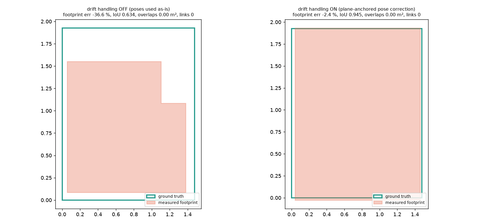
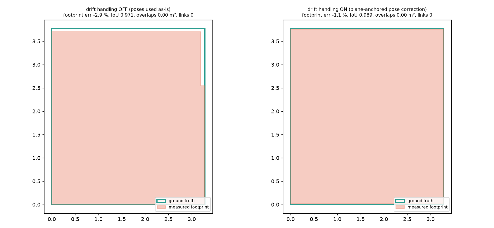
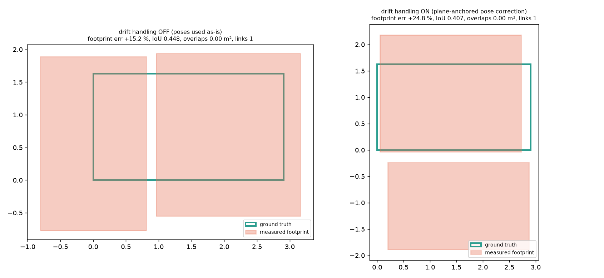
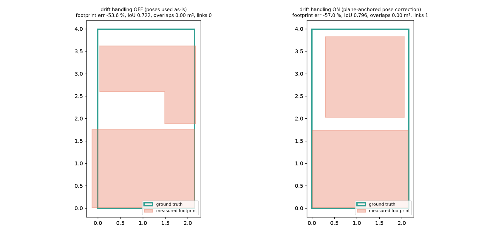
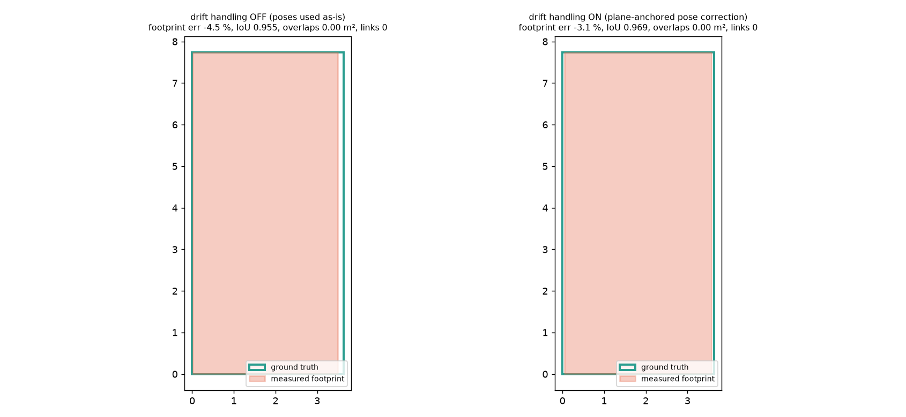

# Benchmark report - real captures (Apple ARKitScenes) vs laser ground truth

> Real iPad Pro captures from Apple's public ARKitScenes dataset (non-commercial research licence): LiDAR depth + ARKit poses (two captures of the same room), the device video, and 8 frames from the walkthrough as the photo set. Ground truth: the FARO laser scan of the same room (`dataprep/room_gt.py`): 2.156 x 3.994 m, ceiling 2.359 m, main wall planes only (fit figure in `data/gt/`). Not an iPhone 15+ capture made with our protocol (no scale card). Openings are not scored (no reliable opening ground truth). The room has no known damage, so every damage detection counts as a false positive. Rebuild the data with `python dataprep/fetch_sample.py`.

## 0. Summary - share of measurements inside each gate

TEST rooms were never used for any design or tuning decision (data/SPLIT.json); DEV rooms were.

| split | tier | captures | walls in gate | ceilings in gate | openings within tolerance (incl. missed/phantom) | footprint in gate | median worst wall error mm |
|---|---|---|---|---|---|---|---|
| TEST | lidar | 15 | 6/60 (10 %) | 8/14 (57 %) | 0/57 (0 %) | 1/15 | 286 |
| TEST | video | 3 | 0/12 (0 %) | 0/2 (0 %) | 0/9 (0 %) | 0/3 | 1391 |
| TEST | photos | 5 | 6/20 (30 %) | 3/5 (60 %) | 0/15 (0 %) | 1/5 | 1244 |

* TEST repeatability (15 LiDAR session pairs): walls within max(1 cm, 0.5 %) in 0/15 pairs, ceiling spread <= 1 cm in 6/15; median largest wall difference 2080 mm.

## 1. Gates at all three tiers

### lidar tier  
Gate: wall <= max(2 cm, 0.5 %); ceiling <= 1.5 cm; opening width <= 2 cm on >= 85 % incl. missed/phantom

| capture | walls ok (max err mm) | ceilings ok (max err mm) | openings | footprint err % | damage detections (all FP) | time s |
|---|---|---|---|---|---|---|
| 42897501_lidar | 0/2 (2263) | 0/1 (19) | 0/4 (+2) | -57.0 | 0 | 37 |
| 42897504_lidar | 0/0 (—) | 0/0 (—) | n/a (no GT) | -100.0 | 0 | 25 |
| 42897508_lidar | 0/4 (1994) | 0/1 (26) | 0/4 (+2) | -65.6 | 1 | 23 |
| 47204552_lidar | 2/4 (109) | 1/1 (2) | 0/5 (+1) | -3.1 | 11 | 104 |
| 47204554_lidar | 0/4 (64) | 1/1 (0) | 0/5 (+1) | -2.1 | 13 | 48 |
| 47204556_lidar | 0/4 (111) | 1/1 (10) | 0/5 (+2) | -2.0 | 5 | 33 |
| 47332915_lidar | 2/4 (41) | 1/1 (2) | 0/2 (+0) | -1.1 | 8 | 44 |
| 47332916_lidar | 0/4 (390) | 1/1 (14) | 0/2 (+1) | -11.4 | 7 | 32 |
| 47332918_lidar | 0/4 (1214) | 1/1 (10) | 0/2 (+2) | -14.1 | 7 | 46 |
| 47334107_lidar | 0/4 (585) | 0/1 (137) | 0/1 (+0) | +24.8 | 0 | 36 |
| 47334109_lidar | 0/4 (1843) | 0/1 (18) | 0/1 (+1) | +53.4 | 1 | 27 |
| 47334110_lidar | 0/4 (265) | 1/1 (7) | 0/1 (+1) | -21.0 | 4 | 52 |
| 48018382_lidar | 0/4 (59) | 1/1 (13) | 0/1 (+2) | -2.4 | 6 | 15 |
| 48018386_lidar | 2/4 (307) | 0/1 (21) | 0/1 (+4) | -20.2 | 5 | 18 |
| 48018387_lidar | 0/4 (96) | 0/1 (19) | 0/1 (+3) | -5.0 | 11 | 15 |

| capture | wall lengths | ceiling height | openings | footprint |
|---|---|---|---|---|
| 42897501_lidar | FAIL | FAIL | FAIL | FAIL |
| 42897504_lidar | FAIL | FAIL | n/a | FAIL |
| 42897508_lidar | FAIL | FAIL | FAIL | FAIL |
| 47204552_lidar | FAIL | PASS | FAIL | FAIL |
| 47204554_lidar | FAIL | PASS | FAIL | FAIL |
| 47204556_lidar | FAIL | PASS | FAIL | FAIL |
| 47332915_lidar | FAIL | PASS | FAIL | PASS |
| 47332916_lidar | FAIL | PASS | FAIL | FAIL |
| 47332918_lidar | FAIL | PASS | FAIL | FAIL |
| 47334107_lidar | FAIL | FAIL | FAIL | FAIL |
| 47334109_lidar | FAIL | FAIL | FAIL | FAIL |
| 47334110_lidar | FAIL | PASS | FAIL | FAIL |
| 48018382_lidar | FAIL | PASS | FAIL | FAIL |
| 48018386_lidar | FAIL | FAIL | FAIL | FAIL |
| 48018387_lidar | FAIL | FAIL | FAIL | FAIL |

### video tier  
Gate: wall / ceiling / opening width within +-3 %; footprint +-3 %

| capture | walls ok (max err mm) | ceilings ok (max err mm) | openings | footprint err % | damage detections (all FP) | time s |
|---|---|---|---|---|---|---|
| 47332915_video | 0/2 (2444) | 0/1 (187) | 0/2 (+2) | +165.7 | 17 | 96 |
| 47334107_video | 0/0 (—) | 0/0 (—) | n/a (no GT) | -100.0 | 0 | 190 |
| 48018382_video | 0/4 (337) | 0/1 (409) | 0/1 (+4) | -27.3 | 7 | 95 |

| capture | wall lengths | ceiling height | openings | footprint |
|---|---|---|---|---|
| 47332915_video | FAIL | FAIL | FAIL | FAIL |
| 47334107_video | FAIL | FAIL | n/a | FAIL |
| 48018382_video | FAIL | FAIL | FAIL | FAIL |

### photos tier  
Gate: wall / ceiling / opening width within +-8 %; footprint +-8 %, correct adjacency, no overlaps

| capture | walls ok (max err mm) | ceilings ok (max err mm) | openings | footprint err % | damage detections (all FP) | time s |
|---|---|---|---|---|---|---|
| 42897501_photos | 2/4 (1244) | 1/1 (116) | 0/4 (+0) | +50.0 | 2 | 16 |
| 47204552_photos | 0/2 (3940) | 1/1 (133) | 0/5 (+1) | -54.1 | 2 | 20 |
| 47332915_photos | 4/4 (120) | 1/1 (21) | 0/2 (+1) | +4.4 | 3 | 16 |
| 47334107_photos | 0/4 (497) | 0/1 (578) | 0/1 (+0) | +52.6 | 3 | 13 |
| 48018382_photos | 0/4 (1473) | 0/1 (815) | 0/1 (+0) | -22.4 | 0 | 12 |

| capture | wall lengths | ceiling height | openings | footprint |
|---|---|---|---|---|
| 42897501_photos | FAIL | PASS | FAIL | FAIL |
| 47204552_photos | FAIL | PASS | FAIL | FAIL |
| 47332915_photos | PASS | PASS | FAIL | PASS |
| 47334107_photos | FAIL | FAIL | FAIL | FAIL |
| 48018382_photos | FAIL | FAIL | FAIL | FAIL |

## 2. Per-wall errors (measured - laser, mm)

| capture | S | E | N | W | ceiling |
|---|---|---|---|---|---|
| 42897501_lidar | +nan | -2263 | +nan | -2263 | +19 |
| 42897501_photos | +1244 | -194 | +1244 | -194 | -116 |
| 42897508_lidar | -674 | -1994 | -674 | -1994 | +26 |
| 47204552_lidar | -109 | -10 | -109 | -10 | -2 |
| 47204552_photos | +nan | -3940 | +nan | -3940 | +133 |
| 47204554_lidar | -46 | -64 | -46 | -64 | +0 |
| 47204556_lidar | -21 | -111 | -21 | -111 | +10 |
| 47332915_lidar | -2 | -41 | -2 | -41 | +2 |
| 47332915_photos | +120 | +29 | +120 | +29 | -21 |
| 47332915_video | +2444 | +nan | +2444 | +nan | -187 |
| 47332916_lidar | -38 | -390 | -38 | -390 | +14 |
| 47332918_lidar | -1004 | -1214 | -177 | -30 | +10 |
| 47334107_lidar | -237 | +585 | -237 | +585 | +137 |
| 47334107_photos | +492 | +497 | +492 | +497 | -578 |
| 47334109_lidar | +1843 | -100 | +1843 | -100 | -18 |
| 47334110_lidar | -265 | -214 | -265 | -214 | +7 |
| 48018382_lidar | -59 | +32 | -59 | +32 | +13 |
| 48018382_photos | -828 | +1473 | -828 | +1473 | -815 |
| 48018382_video | -176 | -337 | -176 | -337 | +409 |
| 48018386_lidar | -307 | +14 | -307 | +14 | +21 |
| 48018387_lidar | -96 | +32 | -96 | +32 | +19 |

## 3. Repeatability (same room, same tier, two captures)

| pair | per-wall difference between the two captures | ceiling height a / b | walls <= max(1 cm, 0.5 %) | ceiling spread <= 1 cm | verdict (repeatable-but-biased vs unrepeatable) |
|---|---|---|---|---|---|
| lidar (48018382_lidar vs 48018386_lidar) | S: +247 mm (tol 10), E: +18 mm (tol 10), N: +247 mm (tol 10), W: +18 mm (tol 10) | 2.474 / 2.482 (spread 7 mm, bias +13/+21 mm) | FAIL | PASS | UNREPEATABLE |
| lidar (48018382_lidar vs 48018387_lidar) | S: +37 mm (tol 10), E: -1 mm (tol 10), N: +37 mm (tol 10), W: -1 mm (tol 10) | 2.474 / 2.480 (spread 6 mm, bias +13/+19 mm) | FAIL | PASS | UNREPEATABLE |
| lidar (48018386_lidar vs 48018387_lidar) | S: -210 mm (tol 10), E: -18 mm (tol 10), N: -210 mm (tol 10), W: -18 mm (tol 10) | 2.482 / 2.480 (spread 1 mm, bias +21/+19 mm) | FAIL | PASS | UNREPEATABLE |
| lidar (47332915_lidar vs 47332916_lidar) | S: +37 mm (tol 16), E: +349 mm (tol 19), N: +37 mm (tol 16), W: +349 mm (tol 19) | 2.690 / 2.701 (spread 11 mm, bias +2/+14 mm) | FAIL | FAIL | UNREPEATABLE |
| lidar (47332915_lidar vs 47332918_lidar) | S: +2452 mm (tol 16), E: +1173 mm (tol 19), N: +175 mm (tol 16), W: -12 mm (tol 19) | 2.690 / 2.697 (spread 8 mm, bias +2/+10 mm) | FAIL | PASS | UNREPEATABLE |
| lidar (47332916_lidar vs 47332918_lidar) | S: +2415 mm (tol 16), E: +824 mm (tol 19), N: +139 mm (tol 16), W: -360 mm (tol 19) | 2.701 / 2.697 (spread 4 mm, bias +14/+10 mm) | FAIL | PASS | UNREPEATABLE |
| lidar (47334107_lidar vs 47334109_lidar) | S: -2080 mm (tol 15), E: +685 mm (tol 10), N: -2080 mm (tol 15), W: +685 mm (tol 10) | 2.656 / 2.500 (spread 156 mm, bias +137/-18 mm) | FAIL | FAIL | UNREPEATABLE |
| lidar (47334107_lidar vs 47334110_lidar) | S: +905 mm (tol 15), E: +742 mm (tol 10), N: +905 mm (tol 15), W: +742 mm (tol 10) | 2.656 / 2.500 (spread 156 mm, bias +137/-18 mm) | FAIL | FAIL | UNREPEATABLE |
| lidar (47334109_lidar vs 47334110_lidar) | S: +2985 mm (tol 15), E: +57 mm (tol 10), N: +2985 mm (tol 15), W: +57 mm (tol 10) | 2.500 / 2.500 (spread 0 mm, bias -18/-18 mm) | FAIL | PASS | UNREPEATABLE |
| lidar (42897501_lidar vs 42897504_lidar) | S: +572 mm (tol 11), E: -3052 mm (tol 20), N: +572 mm (tol 11), W: -3052 mm (tol 20) | 2.376 / 2.500 (spread 124 mm, bias +18/+141 mm) | FAIL | FAIL | UNREPEATABLE |
| lidar (42897501_lidar vs 42897508_lidar) | S: +104 mm (tol 11), E: +19 mm (tol 20), N: +104 mm (tol 11), W: +19 mm (tol 20) | 2.376 / 2.365 (spread 11 mm, bias +18/+6 mm) | FAIL | FAIL | UNREPEATABLE |
| lidar (42897504_lidar vs 42897508_lidar) | S: -468 mm (tol 11), E: +3071 mm (tol 20), N: -468 mm (tol 11), W: +3071 mm (tol 20) | 2.500 / 2.365 (spread 135 mm, bias +141/+6 mm) | FAIL | FAIL | UNREPEATABLE |
| lidar (47204552_lidar vs 47204554_lidar) | S: +2388 mm (tol 18), E: +5790 mm (tol 39), N: +2388 mm (tol 18), W: +5790 mm (tol 39) | 2.365 / 2.500 (spread 135 mm, bias -2/+133 mm) | FAIL | FAIL | UNREPEATABLE |
| lidar (47204552_lidar vs 47204556_lidar) | S: -88 mm (tol 18), E: +101 mm (tol 39), N: -88 mm (tol 18), W: +101 mm (tol 39) | 2.365 / 2.377 (spread 12 mm, bias -2/+10 mm) | FAIL | FAIL | UNREPEATABLE |
| lidar (47204554_lidar vs 47204556_lidar) | S: -2475 mm (tol 18), E: -5690 mm (tol 39), N: -2475 mm (tol 18), W: -5690 mm (tol 39) | 2.500 / 2.377 (spread 123 mm, bias +133/+10 mm) | FAIL | FAIL | UNREPEATABLE |

## 4. Drift accountability (pose correction ON vs poses used as-is)

| capture | drift handling | walls in gate | max wall err mm | ceiling err mm | footprint err | footprint IoU |
|---|---|---|---|---|---|---|
| 48018382_lidar | OFF | 0/4 | 1205 | 4 | -36.6 % | 0.634 |
| 48018382_lidar | ON | 0/4 | 59 | 13 | -2.4 % | 0.945 |
| 47332915_lidar | OFF | 1/4 | 1233 | 7 | -2.9 % | 0.971 |
| 47332915_lidar | ON | 2/4 | 41 | 2 | -1.1 % | 0.989 |
| 47334107_lidar | OFF | 0/4 | 569 | 18 | +15.2 % | 0.448 |
| 47334107_lidar | ON | 0/4 | 585 | 137 | +24.8 % | 0.407 |
| 42897501_lidar | OFF | 0/4 | 1705 | 9 | -53.6 % | 0.722 |
| 42897501_lidar | ON | 0/2 | 2263 | 19 | -57.0 % | 0.796 |
| 47204552_lidar | OFF | 2/4 | 155 | 9 | -4.5 % | 0.955 |
| 47204552_lidar | ON | 2/4 | 109 | 2 | -3.1 % | 0.969 |

Method: ARKit poses are never used as-is. Per room, frames are chunked in time and each chunk gets an (x, y, yaw, z) correction so its points sit on the fitted wall / floor / ceiling planes (joint over chunks with a smoothness prior, 3 iterations); in multi-room captures a door-anchored pose graph then places the rooms. OFF = poses used as delivered.

## 5. Calibration of the confidence intervals

| tier | n measurements | inside 95 % CI | error > 3x half-width ('confident garbage') | by measurement |
|---|---|---|---|---|
| lidar | 151 | 46 % | 29.8 % | area: 36 % (n=14), footprint: 33 % (n=15), height: 93 % (n=14), length: 43 % (n=54), opening_height: 56 % (n=27), opening_width: 33 % (n=27) |
| video | 15 | 60 % | 20.0 % | area: 0 % (n=2), footprint: 0 % (n=3), height: 100 % (n=2), length: 100 % (n=6), opening_height: 100 % (n=1), opening_width: 0 % (n=1) |
| photos | 33 | 91 % | 0.0 % | area: 80 % (n=5), footprint: 80 % (n=5), height: 80 % (n=5), length: 100 % (n=18) |

Intervals: analytic sigma + per-tier systematic terms (`floorscan/uncertainty.py`) x the calibration factor in `floorscan/calibration.json` (currently k = 1: no held-out real calibration captures exist; `bench/calibrate.py --data <dir>`).

## 6. Timing (this machine, CPU only)

| capture | total s | stages (s) |
|---|---|---|
| 42897501_lidar | 37.0 | openings 3.2, stitch 0.0, levels_yaw 0.6, segment 7.8, regions 0.0, room_fit 9.6, damage 13.9 |
| 42897501_photos | 16.1 | rooms 15.6, stitch 0.0, damage 0.4 |
| 42897504_lidar | 25.2 | openings 2.6, stitch 0.0, levels_yaw 0.4, segment 7.2, regions 0.0, room_fit 9.5, damage 4.3 |
| 42897508_lidar | 23.5 | openings 2.0, stitch 0.0, levels_yaw 0.4, segment 7.3, regions 0.0, room_fit 9.3, damage 3.0 |
| 47204552_lidar | 104.2 | openings 12.1, stitch 0.0, levels_yaw 1.0, segment 18.0, regions 0.0, room_fit 57.3, damage 11.8 |
| 47204552_photos | 20.1 | rooms 19.4, stitch 0.0, damage 0.6 |
| 47204554_lidar | 48.0 | openings 4.6, stitch 0.0, levels_yaw 0.7, segment 11.4, regions 0.0, room_fit 21.5, damage 7.3 |
| 47204556_lidar | 32.8 | openings 3.1, stitch 0.0, levels_yaw 0.5, segment 7.6, regions 0.0, room_fit 13.3, damage 7.1 |
| 47332915_lidar | 43.8 | openings 3.3, stitch 0.0, levels_yaw 0.6, segment 8.9, regions 0.0, room_fit 23.4, damage 5.4 |
| 47332915_photos | 16.1 | rooms 15.5, stitch 0.0, damage 0.5 |
| 47332915_video | 96.5 | openings 0.8, stitch 0.0, levels_yaw 0.1, segment 6.9, regions 0.0, room_fit 4.0, damage 6.9, decode 0.0, sfm 0.0, depth_fusion 77.3 |
| 47332916_lidar | 31.6 | openings 2.4, stitch 0.0, levels_yaw 0.5, segment 8.0, regions 0.0, room_fit 14.9, damage 4.3 |
| 47332918_lidar | 46.3 | openings 4.8, stitch 0.0, levels_yaw 0.8, segment 11.0, regions 0.0, room_fit 21.6, damage 6.1 |
| 47334107_lidar | 35.8 | openings 2.2, stitch 0.0, levels_yaw 0.9, segment 12.1, regions 0.0, room_fit 15.4, damage 3.1 |
| 47334107_photos | 13.1 | rooms 12.3, stitch 0.0, damage 0.7 |
| 47334107_video | 190.1 | openings 3.0, stitch 0.0, levels_yaw 1.0, segment 20.2, regions 0.0, room_fit 15.9, damage 2.4, decode 0.0, sfm 0.0, depth_fusion 147.3 |
| 47334109_lidar | 27.4 | openings 2.1, stitch 0.0, levels_yaw 0.7, segment 7.4, regions 0.0, room_fit 12.3, damage 2.9 |
| 47334110_lidar | 51.5 | openings 4.2, stitch 0.0, levels_yaw 0.7, segment 13.1, regions 0.0, room_fit 27.9, damage 2.7 |
| 48018382_lidar | 14.8 | openings 1.5, stitch 0.0, levels_yaw 0.2, segment 2.7, regions 0.0, room_fit 7.1, damage 2.7 |
| 48018382_photos | 12.3 | rooms 12.0, stitch 0.0, damage 0.2 |
| 48018382_video | 95.4 | openings 2.2, stitch 0.0, levels_yaw 0.3, segment 4.3, regions 0.0, room_fit 9.1, damage 4.5, decode 0.0, sfm 0.0, depth_fusion 74.7 |
| 48018386_lidar | 17.7 | openings 1.6, stitch 0.0, levels_yaw 0.4, segment 4.2, regions 0.0, room_fit 8.2, damage 2.0 |
| 48018387_lidar | 15.0 | openings 1.6, stitch 0.0, levels_yaw 0.3, segment 3.3, regions 0.0, room_fit 6.2, damage 3.0 |
