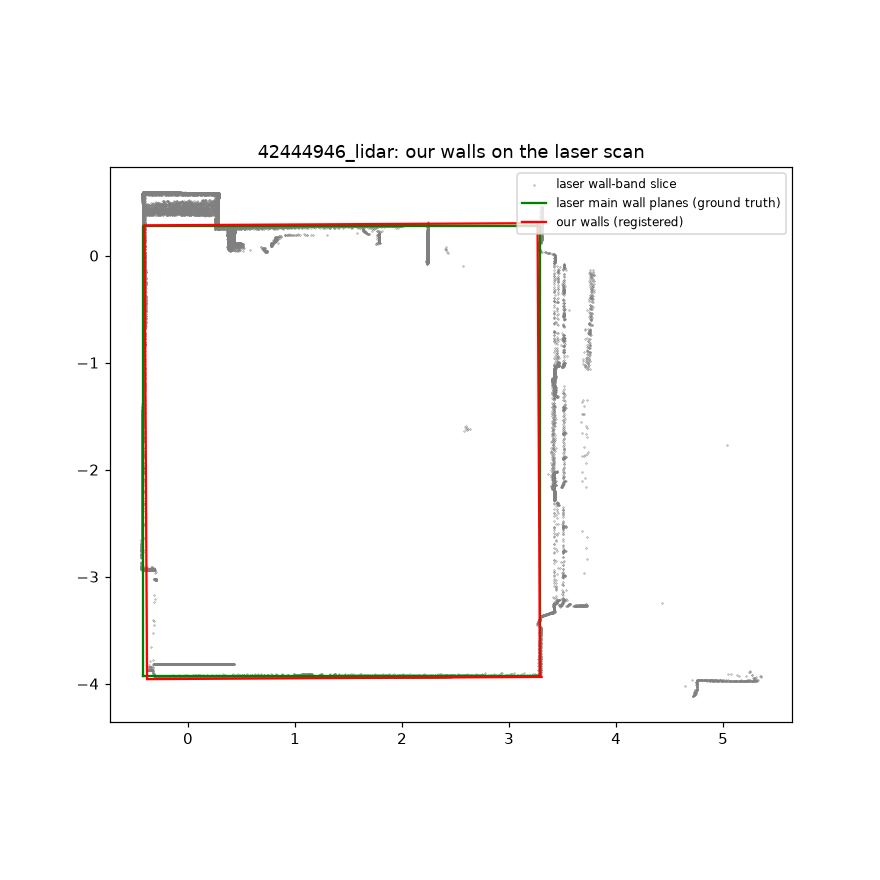
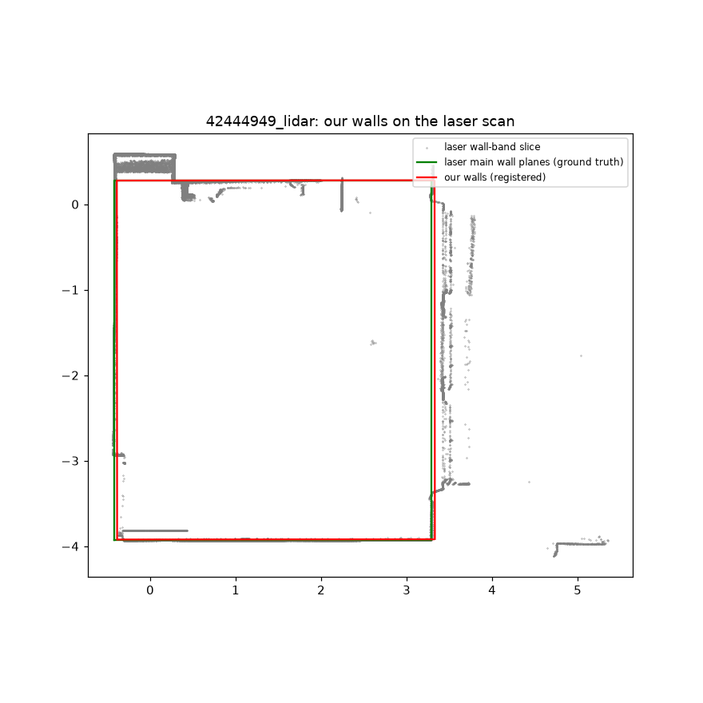

# Diagnosis: real LiDAR wall lengths (source tree: `fixloop\after_src\floorscan`)

Laser ground truth (main wall planes): 3.709 x 4.206 m, ceiling 3.069 m. Offsets: + = our plane lies outside the laser main plane (room too big on that side).

## 42444946_lidar

Output walls: 4.240, 3.672, 4.240, 3.672 m. Registered onto the laser slice by ICP: 66 % of our wall-band points within 5 cm of a laser point.

| wall | side | our plane vs laser main plane | laser pts on our plane / on main plane |
|---|---|---|---|
| 0 | E | **-1.4 cm** | 1950 / 1965 |
| 1 | N | **+2.0 cm** | 40086 / 41166 |
| 2 | W | **-2.3 cm** | 151081 / 155759 |
| 3 | S | **+1.4 cm** | 12486 / 12821 |

Candidate planes in each wall's search window (+-45 cm around the initial wall):

| wall | side | candidate vs laser main plane | our points within 3 cm | share of wall length covered | reaches ceiling (97th pct z >= ceiling - 0.5 m) | taken by pipeline |
|---|---|---|---|---|---|---|
| 0 | E | -1.4 cm | 45861 | 95 % | yes | **taken** |
| 0 | E | +9.1 cm | 123053 | 83 % | yes |  |
| 1 | N | -35.9 cm | 51666 | 28 % | no |  |
| 1 | N | +2.0 cm | 202921 | 75 % | yes | **taken** |
| 1 | N | +24.0 cm | 36303 | 50 % | yes |  |
| 2 | W | -2.3 cm | 332311 | 95 % | yes | **taken** |
| 3 | S | -9.7 cm | 33870 | 94 % | no |  |
| 3 | S | +1.4 cm | 216991 | 94 % | yes | **taken** |

## 42444949_lidar

Output walls: 4.199, 3.716, 4.199, 3.716 m. Registered onto the laser slice by ICP: 69 % of our wall-band points within 5 cm of a laser point.

| wall | side | our plane vs laser main plane | laser pts on our plane / on main plane |
|---|---|---|---|
| 0 | W | **-2.9 cm** | 115335 / 154703 |
| 1 | S | **-1.2 cm** | 12854 / 12821 |
| 2 | E | **+3.6 cm** | 507 / 1841 |
| 3 | N | **+0.5 cm** | 40559 / 41260 |

Candidate planes in each wall's search window (+-45 cm around the initial wall):

| wall | side | candidate vs laser main plane | our points within 3 cm | share of wall length covered | reaches ceiling (97th pct z >= ceiling - 0.5 m) | taken by pipeline |
|---|---|---|---|---|---|---|
| 0 | W | -2.9 cm | 236112 | 95 % | yes | **taken** |
| 1 | S | -1.2 cm | 294742 | 94 % | yes | **taken** |
| 1 | S | +4.4 cm | 61410 | 92 % | yes |  |
| 2 | E | +3.6 cm | 113913 | 95 % | yes | **taken** |
| 3 | N | -36.6 cm | 70724 | 25 % | no |  |
| 3 | N | +0.5 cm | 85769 | 81 % | yes | **taken** |
| 3 | N | +22.8 cm | 53826 | 50 % | yes |  |

