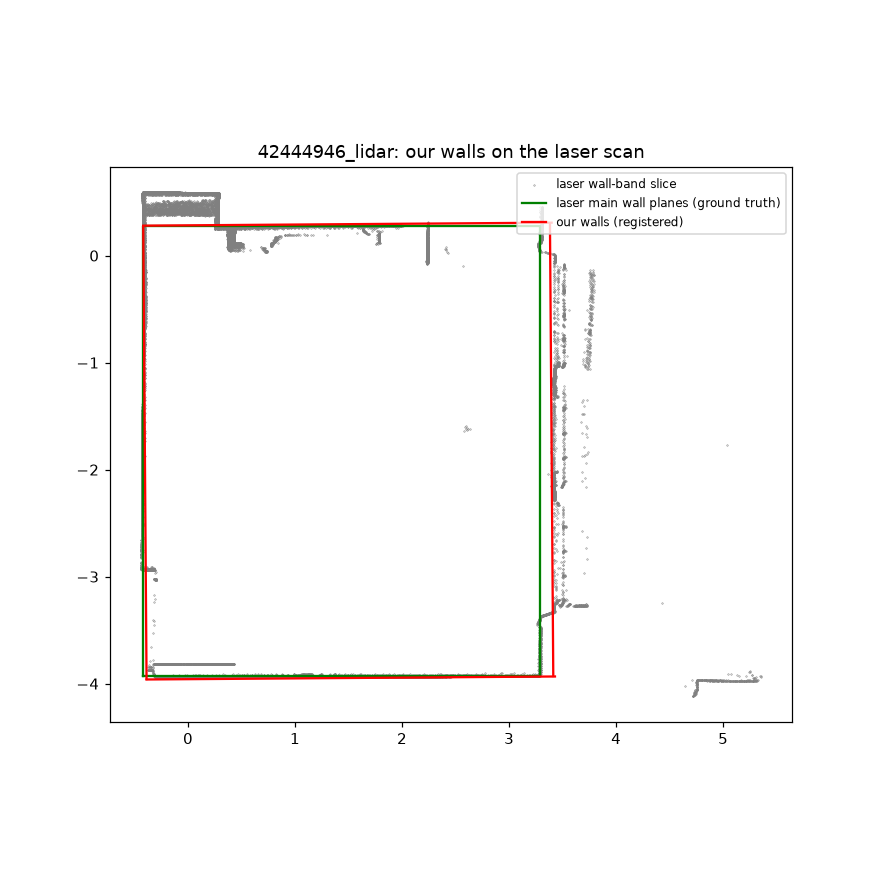
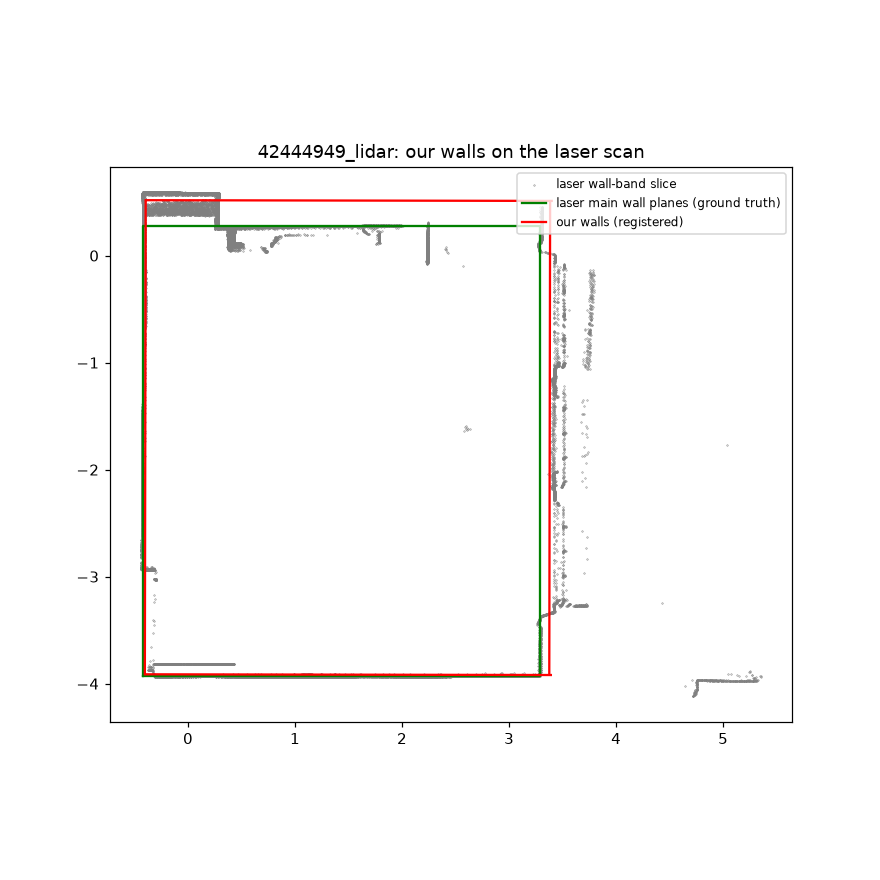

# Diagnosis: real LiDAR wall lengths (source tree: `fixloop\before_src\floorscan`)

Laser ground truth (main wall planes): 3.709 x 4.206 m, ceiling 3.069 m. Offsets: + = our plane lies outside the laser main plane (room too big on that side).

## 42444946_lidar

Output walls: 4.240, 3.801, 4.240, 3.801 m. Registered onto the laser slice by ICP: 66 % of our wall-band points within 5 cm of a laser point.

| wall | side | our plane vs laser main plane | laser pts on our plane / on main plane |
|---|---|---|---|
| 0 | E | **+10.6 cm** | 2985 / 1965 |
| 1 | N | **+2.1 cm** | 46599 / 48803 |
| 2 | W | **-1.4 cm** | 155137 / 155355 |
| 3 | S | **+1.4 cm** | 12503 / 12821 |

Candidate planes in each wall's search window (+-45 cm around the initial wall):

| wall | side | candidate vs laser main plane | our points within 3 cm | share of wall length covered | reaches ceiling (97th pct z >= ceiling - 0.5 m) | taken by pipeline |
|---|---|---|---|---|---|---|
| 0 | E | -0.7 cm | 42419 | 95 % | yes |  |
| 0 | E | +10.6 cm | 122532 | 86 % | yes | **taken** |
| 0 | E | +18.7 cm | 48419 | 83 % | yes |  |
| 1 | N | -35.2 cm | 51908 | 32 % | no |  |
| 1 | N | +2.1 cm | 203092 | 74 % | yes | **taken** |
| 1 | N | +24.2 cm | 37939 | 50 % | yes |  |
| 1 | N | +33.7 cm | 25688 | 37 % | yes |  |
| 2 | W | -1.4 cm | 332593 | 95 % | yes | **taken** |
| 3 | S | -9.8 cm | 36613 | 95 % | no |  |
| 3 | S | +1.4 cm | 225887 | 95 % | yes | **taken** |

## 42444949_lidar

Output walls: 4.430, 3.779, 4.430, 3.779 m. Registered onto the laser slice by ICP: 73 % of our wall-band points within 5 cm of a laser point.

| wall | side | our plane vs laser main plane | laser pts on our plane / on main plane |
|---|---|---|---|
| 0 | W | **-1.8 cm** | 178393 / 179244 |
| 1 | S | **-1.7 cm** | 12869 / 12821 |
| 2 | E | **+8.8 cm** | 669 / 2234 |
| 3 | N | **+24.1 cm** | 4318 / 41260 |

Candidate planes in each wall's search window (+-45 cm around the initial wall):

| wall | side | candidate vs laser main plane | our points within 3 cm | share of wall length covered | reaches ceiling (97th pct z >= ceiling - 0.5 m) | taken by pipeline |
|---|---|---|---|---|---|---|
| 0 | W | -1.8 cm | 245204 | 95 % | yes | **taken** |
| 1 | S | -1.7 cm | 297224 | 95 % | yes | **taken** |
| 1 | S | +3.8 cm | 61515 | 95 % | yes |  |
| 2 | E | +8.8 cm | 117275 | 93 % | yes | **taken** |
| 3 | N | -1.3 cm | 61371 | 78 % | yes |  |
| 3 | N | +24.1 cm | 63878 | 46 % | yes | **taken** |

